

  

  <a href="https://mustafa-omar.com">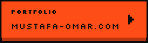</a>
  <a href="https://the-thing.dev">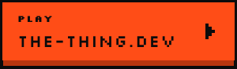</a>

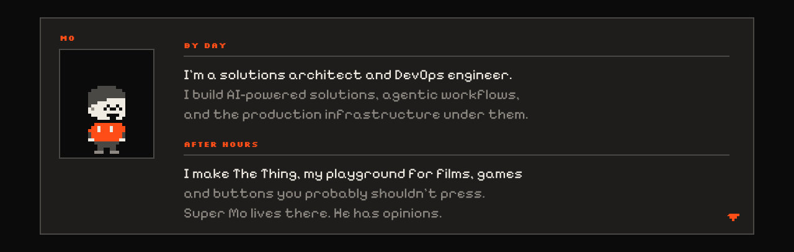

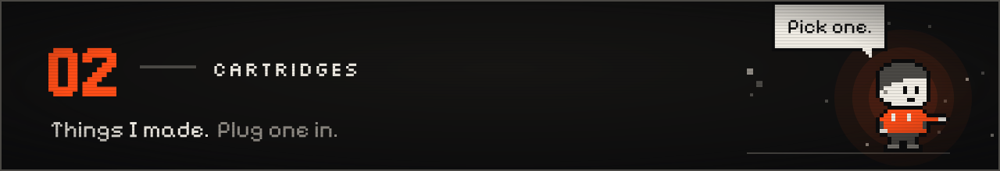

  <a href="https://mustafa-omar.com">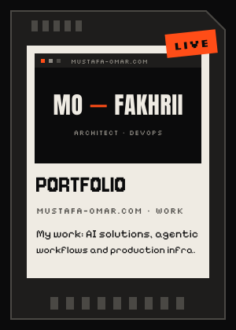</a>
  <a href="https://the-thing.dev">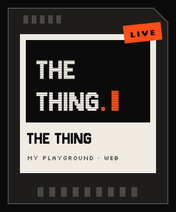</a>
  <a href="https://the-thing.dev/#bug-run">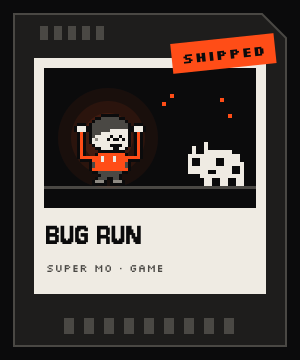</a>

  
  

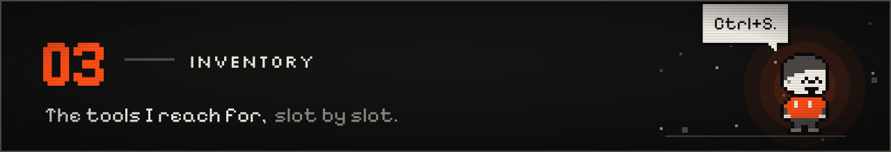

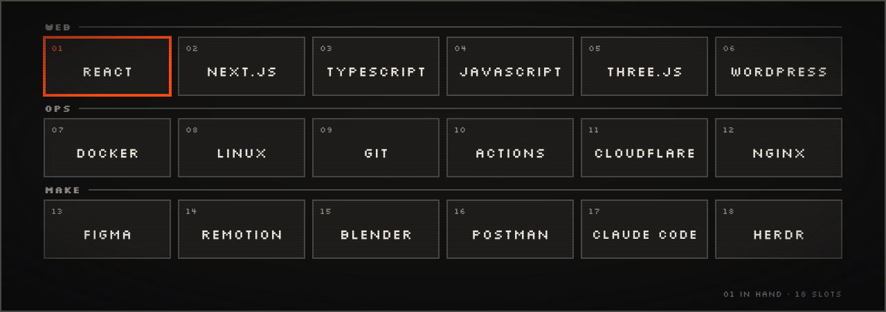

  
  <a href="https://linkedin.com/in/mofakhri">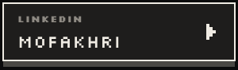</a>
  <a href="mailto:mustafaomardev@gmail.com">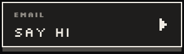</a>

  <a href="https://instagram.com/mo_fakhri98">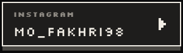</a>
  

