

<a href="https://mustafa-omar.com">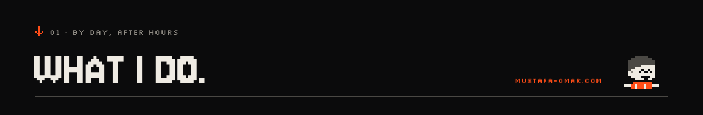</a>

<a href="https://the-thing.dev">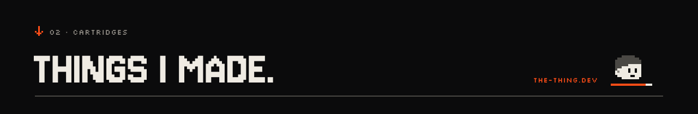</a>

<a href="https://mustafa-omar.com">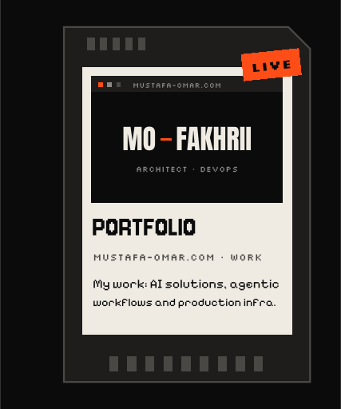</a><a href="https://the-thing.dev">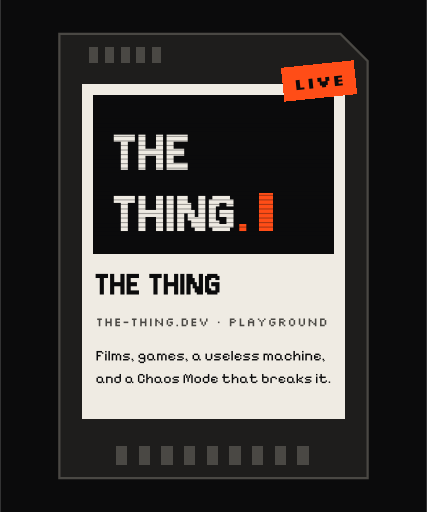</a><a href="https://the-thing.dev/#bug-run">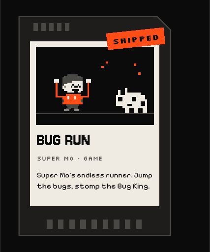</a>

<a href="https://the-thing.dev/#display-block">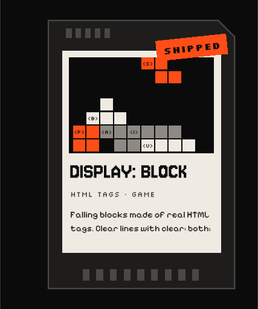</a><a href="https://the-thing.dev">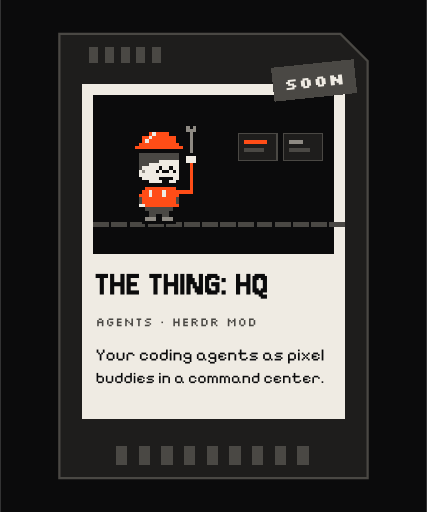</a><a href="https://the-thing.dev">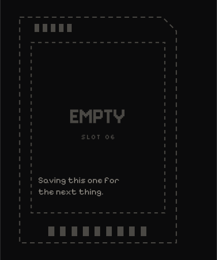</a>

<a href="https://github.com/Mustafa98m">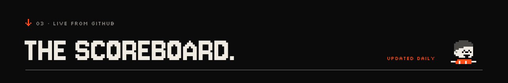</a>

<a href="https://github.com/Mustafa98m"></a>

<a href="https://github.com/Mustafa98m">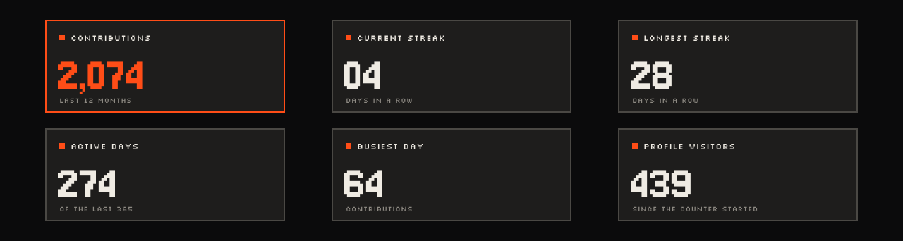</a>

<a href="https://mustafa-omar.com">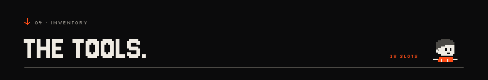</a>

<a href="https://the-thing.dev/#hello-world">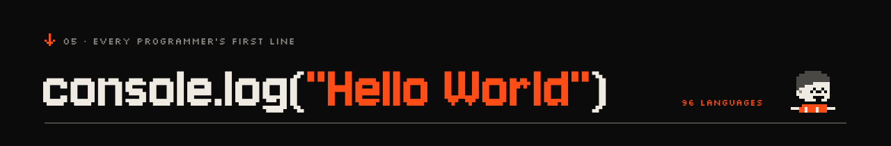</a>

<a href="https://the-thing.dev/#hello-world">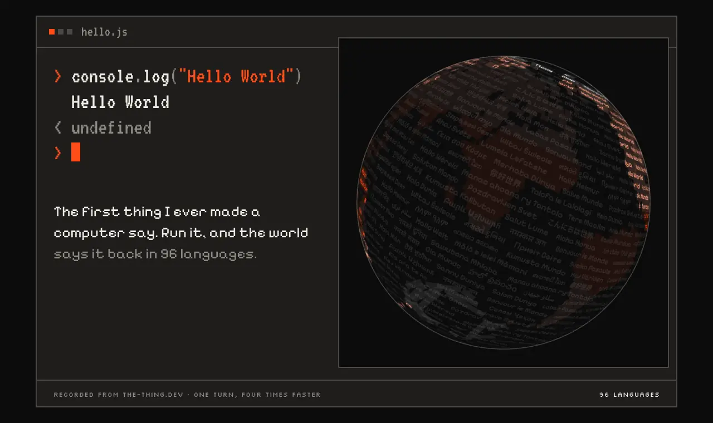</a>

<a href="https://mustafa-omar.com">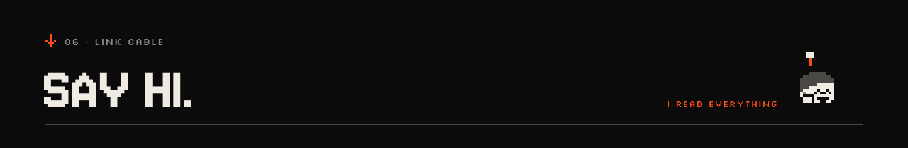</a>

<a href="https://mustafa-omar.com">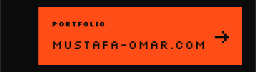</a><a href="https://the-thing.dev">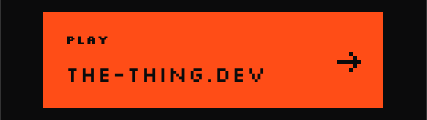</a><a href="https://linkedin.com/in/mofakhri">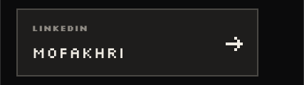</a>

<a href="mailto:mustafaomardev@gmail.com">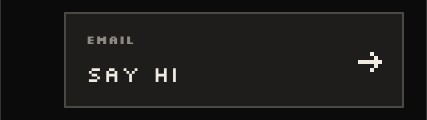</a><a href="https://www.instagram.com/mo_fakhrii/">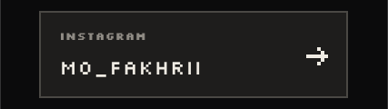</a><a href="https://github.com/Mustafa98m?tab=repositories">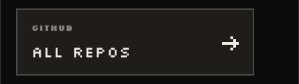</a>

<a href="https://mustafa-omar.com">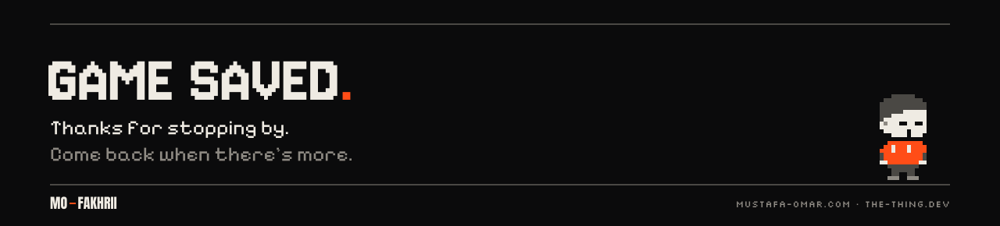</a>

<!-- The visitor count is drawn into art/stats.svg; this hidden badge is what counts each visit. -->

