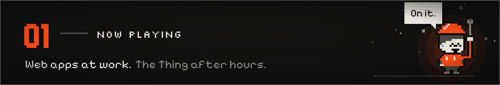
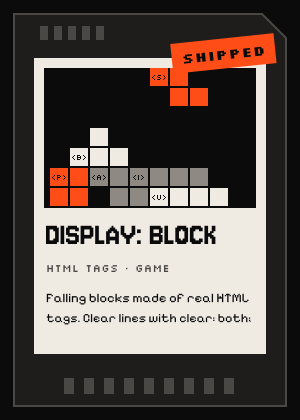
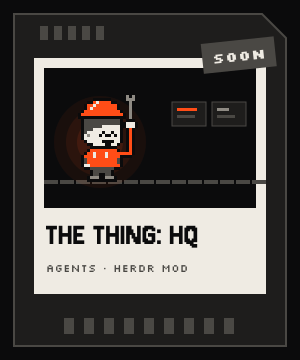
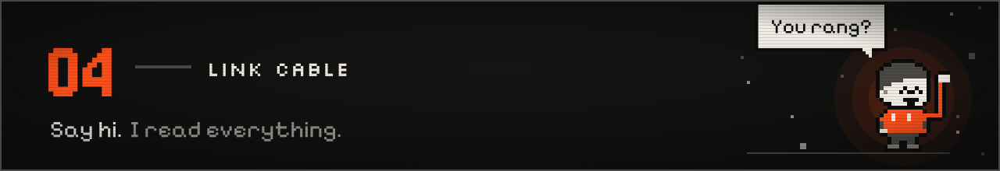

  

  
  
  

 

By day I build web apps and keep the servers, pipelines and deploys behind them running.

After hours I make **[The Thing](https://the-thing.dev)**, my playground for films, games and
buttons you probably shouldn't press. A pixel guy called Super Mo lives there. He runs, he
jumps bugs, and he has opinions.

 

  
  
  
  

| | Cartridge | What it is |
|---|---|---|
| `01` | **[The Thing](https://the-thing.dev)** | My playground. Films, games, a useless machine and a Chaos Mode that breaks the page. |
| `02` | **[Bug Run](https://the-thing.dev/#bug-run)** | Super Mo's endless runner. Jump the bugs, stomp the Bug King. |
| `03` | **[Display: Block](https://the-thing.dev/#display-block)** | Falling blocks made of real HTML tags. Clear a line with `clear: both;`. |
| `04` | **The Thing: HQ** | Your coding agents as pixel buddies in a command center. Private for now. |

 

 

  
  
  

 

  

  

